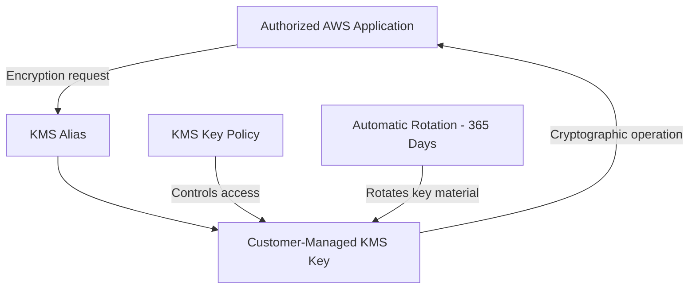
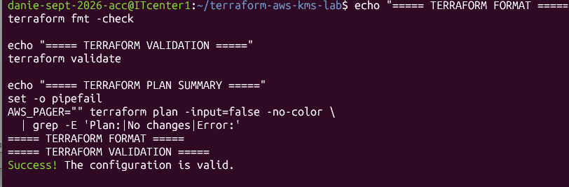

# AWS KMS Customer-Managed Key Terraform Lab

## Project Overview

This project demonstrates how to design an AWS Key
Management Service (KMS) customer-managed encryption key
and a friendly key alias using Terraform.

The project uses automatic key rotation and a key policy
that enables IAM-based permission delegation.

**Deployment status: PLANNED ONLY — NOT DEPLOYED**

## Architecture



## Planned AWS Resources

| Resource | Count |
|---|---:|
| Customer-managed KMS key | 1 |
| KMS alias | 1 |
| **Total** | **2** |

The aws_caller_identity data source reads account
information and does not create an AWS resource.

## Technical Configuration

- AWS Region: us-east-1
- Key usage: ENCRYPT_DECRYPT
- Key specification: SYMMETRIC_DEFAULT
- Automatic key rotation: Enabled
- Rotation interval: 365 days
- Deletion waiting period: 30 days
- Alias: alias/terraform-kms-lab

## Key Policy

The key policy includes the AWS account root principal
with kms:* permissions.

This standard account-principal pattern enables
IAM-based delegation of KMS permissions.

It does not automatically grant every IAM user
permission to encrypt or decrypt.

## Security Design

- Uses a dedicated customer-managed KMS key.
- Uses symmetric encryption.
- Enables automatic key rotation.
- Configures a 30-day deletion waiting period.
- Uses a key policy for access control.
- Does not modify existing AWS-managed KMS keys.

## Security Limitations

- The account-principal policy statement uses kms:*.
- Separate key administrators and users are not defined.
- No encryption or decryption testing was performed.
- No AWS application is connected to the planned key.

A production design should use narrowly scoped
permissions and separate administration from key usage.

## Tools

- Ubuntu Linux (WSL2)
- AWS CLI
- Terraform
- Git and GitHub

## Terraform Validation

Commands:

```bash
terraform fmt -check
terraform validate
terraform plan -input=false -no-color
```

Verified results:

- Terraform formatting passed.
- Terraform validation passed.
- Plan: 2 to add, 0 to change, 0 to destroy.

See [Validation Evidence](docs/validation-evidence.md).

## Deployment Status

No terraform apply has been executed.

No customer-managed KMS key or alias has been
created through this Terraform project.

## Cost Considerations

Customer-managed KMS keys can incur monthly charges.

Cryptographic API requests may incur additional charges.

Review AWS KMS pricing before deployment.

## Future Improvements

- Define separate key administrators and key users.
- Apply narrowly scoped KMS permissions.
- Test encryption and decryption.
- Integrate KMS with Amazon S3.
- Integrate KMS with AWS Secrets Manager.
- Add automated security policy checks.

## Actual Validation Screenshot


