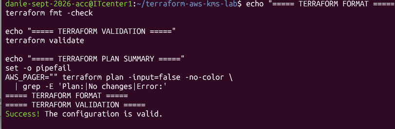

# AWS KMS Terraform Validation Evidence

## Status

PLANNED ONLY — NOT DEPLOYED

## Environment

- Ubuntu Linux (WSL2)
- Terraform v1.17.0
- AWS Region: us-east-1
- AWS CLI

## Verified Results

terraform fmt -check:
Passed.

terraform validate:
Success! The configuration is valid.

terraform plan:
Plan: 2 to add, 0 to change, 0 to destroy.

## Planned AWS Resources

1. Customer-managed KMS key
2. KMS alias

## Security Configuration

- Symmetric encryption key
- ENCRYPT_DECRYPT key usage
- Automatic rotation enabled
- Rotation interval: 365 days
- Deletion waiting period: 30 days
- IAM-based delegation through key policy

## Security Limitations

- Broad account-principal kms:* policy statement
- No separate key-user policy
- No encryption or decryption testing

## Deployment Status

No terraform apply executed.

No KMS resources deployed through this project.

## Screenshot

The screenshot should show actual terminal validation results.
